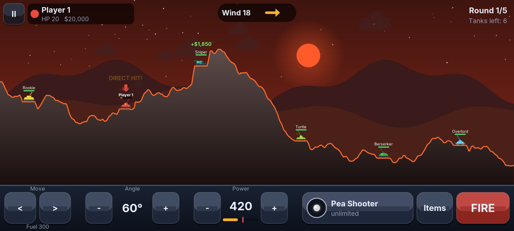
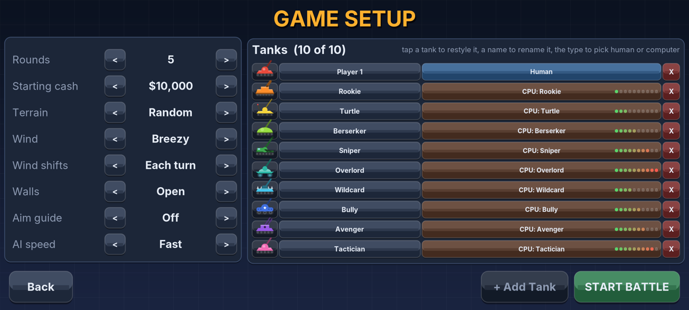
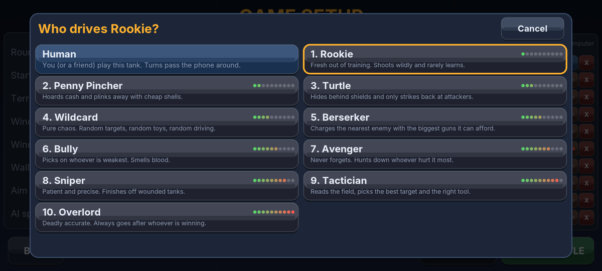
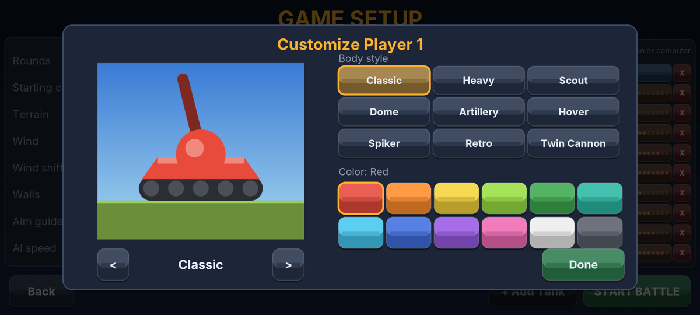
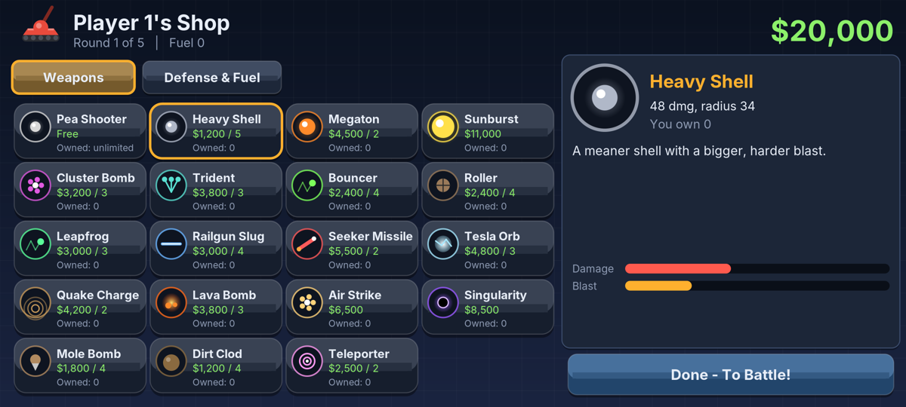
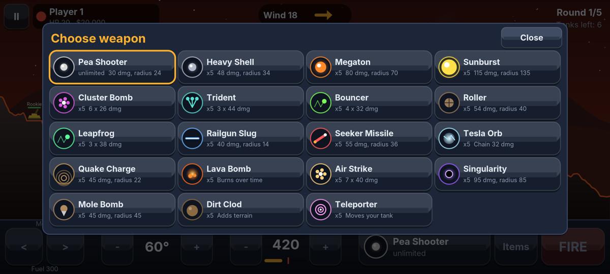
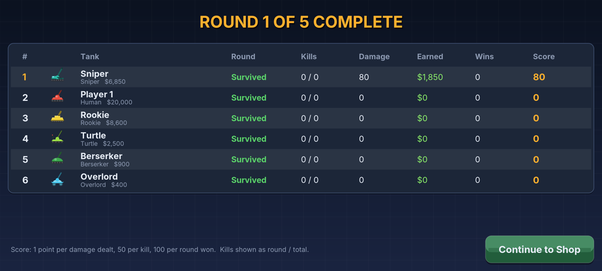
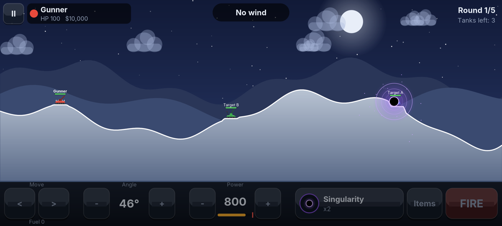
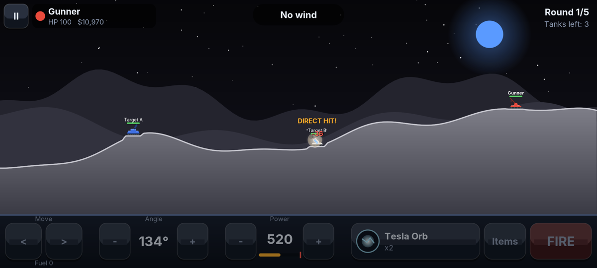
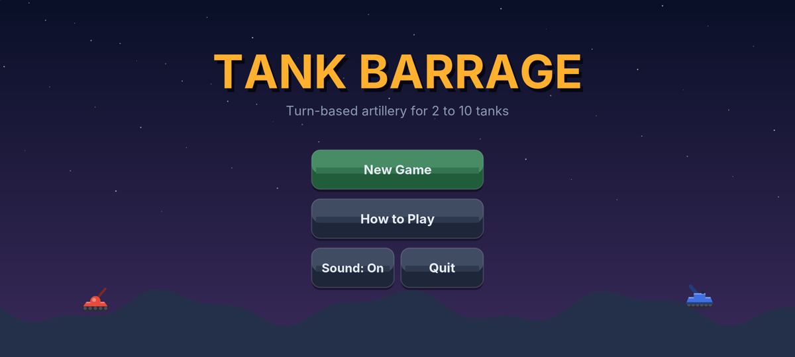

# Tank Barrage

A turn-based artillery tank game for Android, for 2 to 10 tanks. Any mix of human players (pass the phone around) and ten kinds of computer opponents. Drive, aim, pick a weapon, fire, earn money for good hits, and spend it between rounds.



## Install on your phone

1. Copy `release/TankBarrage.apk` to your phone, or open this repository on the phone and download the file.
2. Tap the APK. Android will ask you to allow installs from that app (your browser or file manager). Allow it, then install.
3. Play Protect may warn that the app is from an unknown developer. That's expected for an app you built yourself; choose "Install anyway".

Requires Android 5.0 or newer. Plays in landscape. No permissions, no network, no ads.

## How it plays

- **Setup:** choose 2 to 10 tanks. Each one is Human or one of the ten computer personalities. Tap a tank to pick its body style (9 designs) and color (12), tap the name to rename it. Set rounds (1 to 20), starting cash ($0 to $100,000), terrain (hills, mountains, plains, mesas, valley, islands, or random), wind, wall behavior (open, bounce, wrap), an optional aim guide, and how fast computer turns play. The last setup is remembered.
- **Shop:** before every round, each human spends money on weapons, shields, fuel, repair kits, and parachutes. Items carry over between rounds and can be sold back for half price.
- **Your turn:** hold `<` `>` to drive (burns fuel; climbing burns more), drag on the battlefield to aim (direction = angle, distance = power), fine-tune with `-` `+`, pick a weapon, use items, then **FIRE**. Your previous shot's path is shown faintly so you can correct.
- **Damage:** blasts hurt most at their center. A direct hit does +50% (Railgun: double). Max power drops as your tank is damaged. Destroyed tanks explode. Blasts carve the ground; tanks fall, and long falls hurt without a parachute. If nobody lands a hit for a long stretch, Sudden Death restores everyone's full power.
- **Money:** $20 per point of damage to enemies, $10 per point absorbed by their shields, $250 per direct hit, $1,000 per kill, $2,500 for winning the round.
- **Score:** 1 per damage point, 50 per kill, 100 per round won. Highest score after the last round wins.

### Weapons (19)

Pea Shooter (free, unlimited), Heavy Shell, Megaton, Sunburst, Cluster Bomb, Trident (splits in three at the top of its arc), Bouncer, Roller, Leapfrog, Railgun Slug, Seeker Missile (homes in), Tesla Orb (chain lightning), Quake Charge (ground shockwave), Lava Bomb (lava flows downhill), Air Strike, Singularity (black hole that drags tanks in), Mole Bomb (burrows), Dirt Clod (buries tanks), Teleporter.

Defense: Fuel Can, Repair Kit, Parachute, Light Shield, Heavy Shield, Deflector (bounces shells away).

### Computer opponents (10)

| Skill | Name | Style |
|---|---|---|
| 1 | Rookie | Wild shots, random targets, barely learns |
| 2 | Penny Pincher | Hoards cash, plinks the nearest tank with cheap shells |
| 3 | Turtle | Shields and repairs, hits back only at whoever hurt it, flees and teleports away |
| 4 | Wildcard | Random targets, random toys, random driving |
| 5 | Berserker | Drives at the nearest enemy with the biggest guns, never shields |
| 6 | Bully | Always picks on the weakest tank |
| 7 | Avenger | Hunts whoever has damaged it most |
| 8 | Sniper | Precise, low shots with precision weapons; finishes off wounded tanks |
| 9 | Tactician | Picks the best target and weapon by expected damage, dodges, shields smartly |
| 10 | Overlord | Near-perfect aim, always goes after the leader |

Every computer player aims by simulating the real physics. Skill changes how much of the wind it accounts for, how much random error it adds, and how fast it corrects from its last miss. In 60 simulated all-computer matches, Overlord won about 55% of the matches it played and Tactician about 40%, while Rookie, Penny Pincher, and Turtle almost never won.

| | | |
|---|---|---|
|  |  |  |
|  |  |  |
|  |  |  |

## Building it yourself

No Android Studio or Gradle needed. On Debian or Ubuntu:

```bash
sudo apt-get install default-jdk aapt dalvik-exchange apksigner zipalign android-sdk-platform-23
```

```bash
./build.sh
```

That writes `release/TankBarrage.apk`, signed with `keystore/tankbarrage.keystore` (password `tankbarrage`). Keep that keystore: Android only installs an update over an existing install when both are signed with the same key.

```bash
./build.sh test
```

That also plays 20 all-computer matches headless (checking for crashes and rounds that never end), fires every weapon on a test battlefield, and renders every screen to `build/shots/`.

## Code layout

- `src/core/` holds the whole game in plain Java with no Android dependencies: physics, terrain, weapons, AI, screens, procedural tank art, and synthesized sound effects. It draws through the small `Gfx` interface.
- `src/android/` is the Android shell: the activity, a SurfaceView render loop, a Canvas implementation of `Gfx`, SoundPool audio, and saved settings.
- `src/desktop/` is a test harness that implements `Gfx` with Java2D, for screenshots and simulations. It is not part of the APK.
- `android/` has the manifest and launcher icons.
